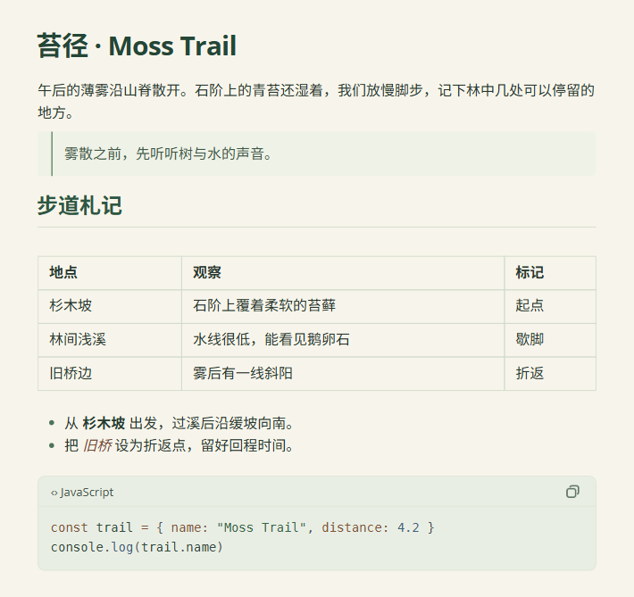

# AutumnMark Themes

AutumnMark reads [catalog.json](catalog.json) from this repository’s public
`main` branch. In AutumnMark, open **设置 → 主题 → 在线主题** to browse and
install themes.

## 苔径 · Moss Trail

A light theme with warm paper, a moss-green interface, and amber syntax
accents. Its sample shows headings, quotes, tables, and code in AutumnMark.

[Download the theme](themes/moss-trail/1/theme.theme.json) ·
[Example Markdown](themes/moss-trail/1/example.md)

## Contributing

Export your theme from AutumnMark’s theme editor and add it under
`themes/<slug>/<revision>/theme.theme.json`. Include a preview and update
`catalog.json` with a stable lowercase ID, the built-in base theme, and the
SHA-256 of the published JSON file. Increase the revision when updating a
theme and retain earlier revisions for cached catalogs.
